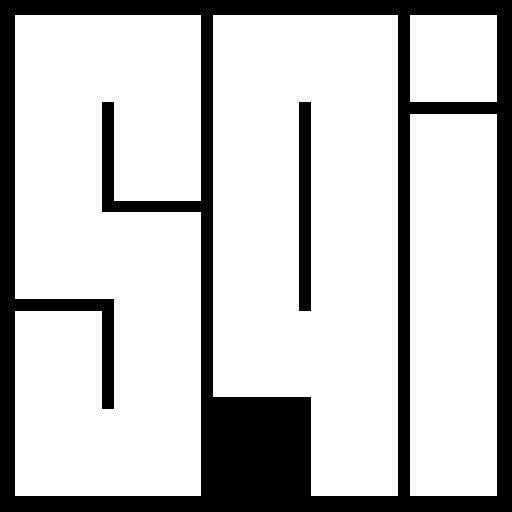

# 

`sqi` (pronounced "sky") is an open source distributed task and render farm manager built for modern production pipelines. It runs on a handful of local workstations and scales to hybrid on-premises and cloud infrastructure without changing how you work.

📖 **[Documentation](https://uberware.github.io/sqi/)** — quickstart, architecture, configuration, and full reference.

> **Status:** pre-1.0. `sqi` schedules OpenJD jobs (including the `EXPR` expression-language extension) on pull-based workers, with products and presets, DCC submitters, opt-in authentication (local accounts, API keys, RBAC, LDAP/AD, OAuth2/OIDC SSO), run-as-user task isolation on POSIX and Windows, SQLite or PostgreSQL state, an embedded or external NATS broker, and an optional high-availability scheduler. Auth is off by default. Contributions, feedback, and discussion welcome.

---

## Why `sqi` exists

The render farm management space is in an awkward moment. Legacy on-premises systems are aging out of active development. The primary cloud-native alternative requires deep AWS infrastructure investment, locks you into a single provider, and introduces workflow constraints that don't match production realities. A lot of studios are looking for a third option.

`sqi` is that option. It draws on years of experience building and operating Smedge (Uberware's long-running render farm product) and applies those lessons to a clean, modern architecture that works wherever your compute lives — local network, cloud, or both.

---

## Design goals

**Simple by default.** A single binary gets a working farm. Workers on other machines run a second binary and can find the server automatically. No external database, no message broker configuration, no cloud account required to get started.

**Scalable when needed.** The same software that runs your five-machine studio farm can be deployed in a distributed, high-availability configuration with a separate database, message broker, and workers across multiple cloud providers. The upgrade path is configuration, plus one command to copy an existing SQLite farm into PostgreSQL.

**Not tied to any cloud provider.** Workers run on Linux, macOS, and Windows — bare metal, VMs, or containers. Cloud compute locations are supported across AWS, GCP, Azure, and any provider that can run a container or a binary. Your control plane runs where you want it.

**OpenJD compatible.** `sqi` adopts the [Open Job Description](https://github.com/OpenJobDescription/openjd-specifications) format as its native job execution layer — not an import step or a partial translation, but the format `sqi` jobs are authored and validated in directly. It is an open standard designed for portability. `sqi` runs the official OpenJD conformance test suite on every CI build and publishes the current pass rate and known gaps at [`docs/openjd-conformance.md`](docs/openjd-conformance.md). A template that opts into an OpenJD extension `sqi` does not implement is rejected, so it is never run with the extension ignored. The official `EXPR` (expression language) extension is supported; see [`docs/openjd-extensions/expr.md`](docs/openjd-extensions/expr.md).

**General purpose.** Rendering is the primary use case and the domain `sqi` is designed around, but the job model is general. Any workload expressible as a command with defined inputs, outputs, and environment is a valid `sqi` job — simulation, transcoding, machine learning pipelines, data processing, software development, or anything else a studio runs at scale.

---

## Key features

- **Farms and queues** organize work hierarchically. Configuration — scheduling policy, worker affinity, usage pool limits — can be set at the farm level and overridden per queue, so you're not repeating yourself on every job submission. Storage doesn't need this: a storage location already maps each compute location to its own root path, so jobs resolve the right path wherever they run without per-queue configuration.

- **Products and presets** are the authoring layer above raw job descriptions. A product defines a class of work (an Arnold render, a Houdini sim, an ffmpeg transcode) in terms of user-friendly parameters and how they map to commands. A preset is a ready-to-use product definition for a specific tool, installable from a community library directly through the web UI.

- **Community preset library** is a public repository of product presets covering major DCCs — Arnold, Blender, Houdini, Maya, Nuke, After Effects, Cinema 4D, and more. Browse, install, and customize presets from within the `sqi` interface. Community contributions welcome.

- **Named storage locations** provide a clean abstraction over where data lives. A location named `nas_shows` might resolve to `/mnt/nas/shows` on a local Linux worker, `Z:\shows` on a Windows worker, and `s3://studio-bucket/shows` on a cloud instance. Jobs reference location names; workers resolve them. Built-in support for S3-compatible object storage (AWS S3, Backblaze B2, Cloudflare R2, MinIO, and others).

- **Path translation** handles the fact that different applications deal with cross-platform and cross-environment paths differently. Product definitions declare how paths should be resolved — baked into the command line, passed as remapping arguments, set as environment variables, or staged locally before execution.

- **Usage pool management** tracks concurrent usage of any shared, finite resource across all workers. Tell `sqi` you have 20 Arnold render licenses (or a per-show task cap, or any other limit) and it ensures no more than that many tasks run at once, globally, across every compute location. You set the limit; `sqi` enforces it.

- **Pull-based workers** register with the farm and pull assigned tasks rather than receiving pushed assignments. Workers can be added, removed, and scaled without the scheduler needing to manage their lifecycle. This makes auto-scaling and ephemeral cloud workers straightforward.

- **Layered authentication** — from no auth at all (local network trust, appropriate for small private farms) through local accounts, API keys, role-based access control, LDAP/Active Directory, and OAuth2/OIDC for SSO. Auth is off by default: set `auth.enabled: true` to turn it on, and see [docs/auth.md](docs/auth.md) for the model, roles, and identity-provider setup.

- **Web UI** is the primary interface. No required desktop application. Real-time job and worker status, log streaming, preset management, product configuration, and farm administration — all in a browser.

- **DCC submitters** for Maya, Houdini, Nuke, 3ds Max, VRED, Blender, Cinema 4D, After Effects, Unreal Engine, Katana, KeyShot, Silhouette, Fusion, and Modo via the [`sqi-submitter`](docs/dcc-submitters.md) Python package — in-application submission with per-host scene extraction and pre-fill, built on top of the [`sqi-sdk` Python library](docs/python-client.md), which covers scripted submission and pipeline integration on its own.

---

## Deployment

**All-in-one (simple mode)**

```sh
sqi-server          # runs the scheduler, API, web UI, everything
sqi-worker          # run on each render node — finds the server automatically
```

On a local network, workers discover the server via mDNS and connect without any configuration. Open a browser and start submitting.

There is no authentication in this mode: the server trusts the local network. To require logins, set `auth.enabled: true` and see [docs/auth.md](docs/auth.md), which covers the first-admin bootstrap, roles, API keys, and connecting a directory or SSO provider. Traffic is unencrypted in this mode too; [docs/tls.md](docs/tls.md) covers turning on TLS for the API and the worker transport, which is a separate opt-in setting.

See the [Quickstart](docs/quickstart.md) for a full walkthrough (binary or Docker Compose), including creating a farm and queue and submitting your first job.

**Distributed (production mode)**

State in PostgreSQL and the message bus on a NATS cluster you run, with workers connecting to the cluster directly. Set `store.driver: postgres` for the store (see [Running on PostgreSQL](docs/operations.md#running-on-postgresql) and [`deploy/docker-compose.postgres.yml`](deploy/docker-compose.postgres.yml)) and `nats.mode: external` for the broker (see [Running on an external NATS cluster](docs/operations.md#running-on-an-external-nats-cluster) and [`deploy/docker-compose.nats-cluster.yml`](deploy/docker-compose.nats-cluster.yml)); the cluster outlives `sqi-server` restarts and, with three stream replicas, the loss of a node. With `ha.enabled`, several `sqi-server`s share the database and the broker account: one leader schedules and serves the API while the others wait as standbys (see [Running more than one server](docs/operations.md#running-more-than-one-server-high-availability) and [`deploy/docker-compose.ha.yml`](deploy/docker-compose.ha.yml)). Without it, one `sqi-server` runs per database and per broker account. Kubernetes manifests are not provided.

Both modes run the same software. The difference is configuration; an existing SQLite farm moves to PostgreSQL with `sqi-server store copy` (see [Moving to PostgreSQL](docs/operations.md#moving-to-postgresql)), and to an external broker by changing `nats.mode` (see [Switching broker mode](docs/operations.md#switching-broker-mode)).

---

## Status and roadmap

`sqi` is pre-1.0 and under active development. Planned work, including optional LLM integration for farm management, is described in [ROADMAP.md](ROADMAP.md). Feedback on priorities is welcome — [open an issue](https://github.com/uberware/sqi/issues/new) or [start a discussion](https://github.com/uberware/sqi/discussions/new/choose).

---

## Contributing

Contributions are welcome at all stages — code, preset definitions, documentation, bug reports, and design discussion.

The community preset library in particular benefits from people who know their tools well. If you have a working submission setup for a DCC or tool, you can share it as a `sqi` preset without any Go or server-side knowledge.

See [CONTRIBUTING.md](CONTRIBUTING.md) for guidelines.

---

## License

`sqi` is licensed under the [GNU Affero General Public License v3.0](LICENSE) (AGPL-3.0). This means you can use, modify, and self-host `sqi` freely. If you offer `sqi` (or a modified version) as a network service, the AGPL requires you to make your source available.

A commercial license is available for organizations that require it. Contact [robin@uberware.net](mailto:robin@uberware.net).

---

## About

`sqi` is built by [Uberware](https://www.uberware.net), the company behind [Smedge](https://www.uberware.net/smedge), a render farm manager with over two decades of production use. `sqi` is a clean-break successor designed for the infrastructure realities of the next decade.
